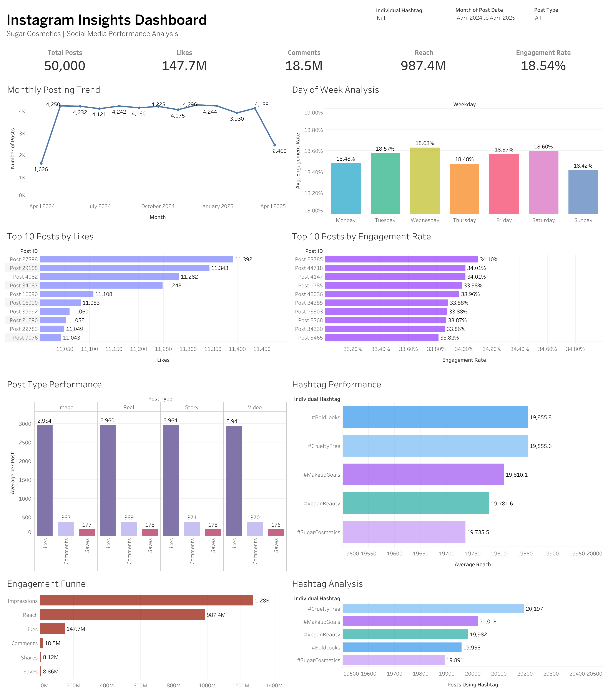

# Instagram Performance Analysis

An end-to-end social media analytics project analysing Instagram performance to uncover engagement patterns, content trends and opportunities to improve content strategy.

## 📊 Dashboard

### 🔗 Interactive Dashboard

[View the interactive dashboard on Tableau Public](https://public.tableau.com/views/InstagramTableau_17868941299000/Dashboard1)

---

## 📌 Project Overview

This project analyses Instagram performance data to understand how content performs across key social media metrics and identify patterns that can support better content decisions.

The analysis focuses on translating raw Instagram performance data into meaningful KPIs, visualisations and actionable insights through an interactive Tableau dashboard.

## 🎯 Business Objectives

The analysis was designed to answer questions such as:

- How is the account performing overall?
- Which posts and content types generate the strongest engagement?
- How does engagement change over time?
- Which factors appear to influence post performance?
- Are there identifiable patterns between reach, impressions and engagement?
- What opportunities exist to improve future content strategy?

## 🛠️ Tools & Skills

**Tableau** — Dashboard development, calculated fields, interactive visualisation and exploratory analysis  
**Excel / CSV** — Data preparation and validation  
**Data Visualisation** — KPI cards, trend analysis and comparative visualisations  
**Business Analytics** — Translating analytical findings into business recommendations

## 📁 Repository Structure

    instagram-performance-analysis/
    │
    ├── data/
    │   └── Instagram performance dataset
    │
    ├── images/
    │   └── instagram-performance-dashboard.png
    │
    ├── tableau/
    │   └── instagram-performance-analysis.twbx
    │
    └── README.md

## 🔍 Analysis

The project evaluates Instagram performance across multiple dimensions, including overall account performance, engagement behaviour, post-level performance and trends over time.

The Tableau dashboard brings these measures together into a single interactive analytical view, allowing users to explore performance patterns and compare different aspects of Instagram activity.

## 💡 Key Insights

Detailed findings from the analysis are presented through the dashboard, with emphasis on identifying:

- High-performing content and posts
- Engagement patterns
- Performance trends over time
- Relationships between key social media metrics
- Opportunities for improving content performance

## 💼 Business Recommendations

The analytical findings can be used to support decisions around:

- Content prioritisation
- Posting strategy
- Engagement optimisation
- Performance monitoring
- Future social media experimentation

## 📂 Project Files

- **Dataset:** Available in the `data` folder
- **Tableau Workbook:** Available in the `tableau` folder
- **Dashboard Image:** Available in the `images` folder
- **Interactive Dashboard:** [Tableau Public](https://public.tableau.com/views/InstagramTableau_17868941299000/Dashboard1)

---

### Author

**Vishnu Narayanan Girishbabu**

Business & Data Analytics | SQL | Python | Power BI | Tableau | Supply Chain & Operations
